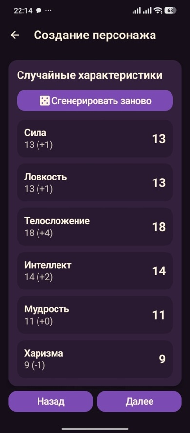
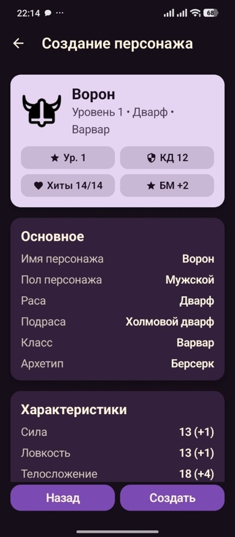
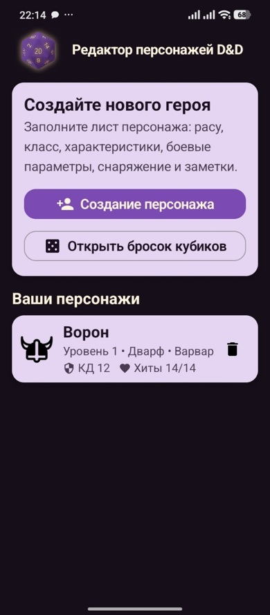
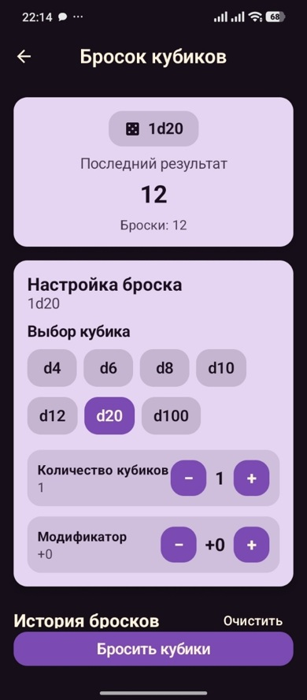

# DnD Redactor

Android application for creating and managing Dungeons & Dragons characters.

The app allows you to build a character step by step: choose race, class, archetype, background and ability scores. Reference data is loaded from a remote D&D API, while created characters are stored locally on the device.

## Features

- Character creation wizard (race, class, archetype, background, ability scores)
- Reference data from remote D&D API
- Local storage of characters
- Modern UI built with Jetpack Compose

## Tech Stack

- Language: Kotlin
- UI: Jetpack Compose
- Local database: Room
- Networking: Retrofit
- Dependency injection: Hilt
- Image loading: Coil

## Screenshots

<p align="center">
  
  
  
  
</p>

<p align="center">
  
  
  
  
</p>
## Installation

1. Clone the repository:
```bash
git clone https://github.com/nikitasemenchenko/DnDRedactor.git
```

2. Open the project in Android Studio.

3. Sync Gradle and run the application on an emulator or a physical device.

## Requirements

- Android 8.0 (API level 26) or higher
- Android Studio Hedgehog or newer

## Project Structure

```
DnDRedactor/
├── app/
│   ├── src/main/java/     # Application source code
│   └── src/main/res/      # Resources
├── build.gradle.kts
└── ...
```
